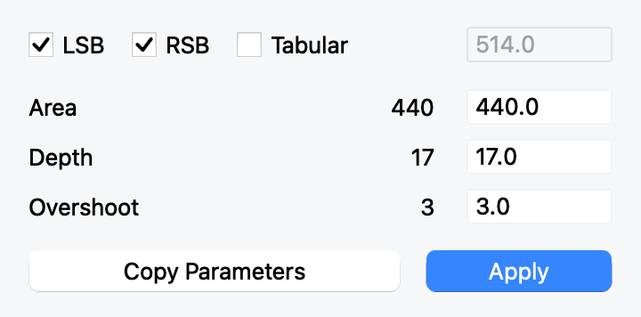

# HT Letterspacer for FontLab 9

A self-contained gateway to the unchanged HTLetterspacer engine, with a compact FontLab interface and optional rules manager.

## Install — no Git or Terminal required

Download **HT-Letterspacer-FontLab-1.0.0.zip**, unzip it, and double-click **Install HT Letterspacer.vfpy**. Choose Open With → FontLab 9 if another application owns the file association. The same file can be dropped onto FontLab 9.

Installation starts automatically. It downloads the pinned original plugin from GitHub, verifies its archive and engine checksums, installs the gateway, and refreshes Scripts. FontLab 9 with Python 3.9+ and an internet connection are required; Glyphs and an external Python installation are not. Tested in FontLab's Python 3.11 runtime on macOS. Windows uses the same installer and its native FontLab data path; a Windows end-to-end run remains a release-validation item.

Open **Scripts → HT Letterspacer → HT Letterspacer**. You can delete the download afterward. The installer does not upload fonts or settings and does not modify the user's fonts. After updating a gateway already loaded in memory, restart FontLab once.

Installed scripts:

- **HT Letterspacer** and **Apply HTLS Values** open the compact palette.
- **Apply HTLS Config** spaces the selection using the font's saved configuration.
- **HTLS Manager** opens the optional full rules/preview manager.
- **Uninstall HT Letterspacer** removes managed launchers and retains a recoverable runtime backup.

## Installed files and updates

The installer queries `fontlab.flPreferences().dataPathDefault`, the path FontLab's Scripts panel actually scans. Defaults are `~/Library/Application Support/FontLab/FontLab 9` on macOS and the user's **Documents/FontLab/FontLab 9** on Windows, including redirected Documents folders.

```text
FontLab 9/
  Scripts/HT Letterspacer/          # portable launchers only
  Extensions/HT Letterspacer/
    installation.json              # active release pointer
    releases/1.0.0-<installation>/
      htls_fontlab/                # gateway
      vendor/HTLetterspacer/       # original source, private to this installation
      upstream-source.zip          # complete unchanged original archive
      LICENSE, NOTICES.txt, ...
```

Launchers resolve this layout relative to their own file. No installed file depends on a developer checkout or the downloaded ZIP's location. Original Glyphs bundle symlinks are not activated; their exact content remains in the retained source ZIP. The plugin is not registered with Glyphs itself.

Rerun the installer to update or repair. Verification and staging happen before any active files are changed. Unrelated scripts are not overwritten; failed activation restores the prior launchers and receipt. Earlier runtimes remain available under releases. Uninstall moves the owned runtime to an `Extensions/.HTLS-uninstalled-*` backup and preserves fonts and other scripts.

## Build and managed deployment

```sh
python3 tools/build_release.py
python3 -m unittest discover -s tests -v
```

The `dist/` directory contains the customer ZIP, standalone `.vfpy`, full corresponding source ZIP, and SHA-256 checksums. See [release validation](docs/RELEASE.md) and the customer [installation instructions](docs/INSTALL.txt).

For development, keep the original checkout beside this repository or set `HTLS_UPSTREAM`. Developer scripts can still run from this checkout. To create a self-contained managed installation from source:

```sh
python3 install.py --data-dir "/path/to/FontLab 9"
```

An optional `--upstream-archive /path/to/pinned.zip` permits offline managed deployment; checksum validation still applies. The customer installer always obtains the original from GitHub.

## Compact palette

Select glyphs in FontLab, then open **HT Letterspacer**. Set Area, Depth and Overshoot and click **Apply**. The middle column shows the current master's saved values; the editable right column supplies the manual values. LSB/RSB choose the sides to change. Tabular uses the entered target advance width; Auto (zero) retains each glyph's width. A protected side takes precedence and leaves a tabular glyph unchanged.

Apply affects the selection in the current master, preserves live component placements and registers native history. It uses the typed values independently of stored rules. Copy Parameters copies the three values as JSON for the FontLab adapter API. The palette is 360 × 178 logical pixels before showing result feedback; it has no tabs or embedded preview.



## Optional manager workflow

1. Open a font and launch **HTLS Manager**. Choose the master in the window.
2. Edit **Font rules**, then click **Update rule**. Matching, specificity, percent/absolute Area and Depth, reference glyphs, glyph lists, suffix filters and default rules come from upstream.
3. Set master-specific Area/Depth overrides in **Master rules**. Uncheck an override to inherit the font rule.
4. Adjust Area, Depth, Overshoot and sampling Step under **Parameters & preview**. Preview text accepts ordinary Unicode text or `/H /o /zero.tf` glyph names. The outline/area preview does not modify the font.
5. Use **Apply to selection** or **Apply to current tab**. **All masters** expands this to real master layers only. **Keep components** preserves the placement of live components throughout the font, including scaled, rotated and sheared references. Turning it off lets components follow their bases.
6. **Live tab apply** writes the current Glyph-window contents when you change working parameters or update rules. Disable it when finished tuning. Each apply registers a FontLab history operation.
7. **Save configuration** embeds settings in the font. Save the font as VFJ or VFC to persist them on disk. Closing the tool without saving configuration discards working rule/parameter edits; applied spacing remains in the font until undone.

**Areas in Glyph window** enables the non-destructive native overlay. It follows the active Glyph window, colours areas by matched rule, and labels the active glyph's rule. It needs a FontLab 9 build exposing `flCanvas.appendPythonPainter`; the standalone preview remains available on builds without it. Closing the tool removes the painter and stops live work. The overlay limits itself to 100 displayed glyphs to bound background work.

**Inspector** explains the chosen rule and lists matching fallbacks. Its JSON classification override editor handles font-specific categories that differ from the bundled GlyphsInfo data, for example:

```json
{"customGlyph": {"category": "Letter", "script": "latin", "case": 2}}
```

## Configuration exchange

**Import…** reads upstream v2 JSON setups and the legacy comma-separated `.yml`/`.py` rules format. Legacy files are parsed as text and never executed. Masters map by name; unmatched names prompt for an explicit mapping or Skip. Import changes working state; Save configuration commits it to the font.

**Export setup…** writes upstream-compatible JSON with IDs, rules, master overrides and parameters. An optional `fontlab` extension retains sampling steps and classification overrides; Glyphs ignores that extension. **Export legacy…** is intentionally lossy (upstream legacy format cannot represent every v2 setting).

The FontLab storage key is `com.htfonts.letterspacer.fontlab.v1` in `flPackage.packageLib`. Existing unrelated lib entries are preserved. Master parameter values imported from Glyphs (`paramArea`, `paramDepth`, `paramOver`, `paramFreq`) are read automatically. The adapter's own saved values then take precedence. Settings are not read from sidecar files while spacing.

## Connection to upstream

`htls_fontlab/upstream.py` loads `config.py`, `rules.py` and `engine.py` **byte for byte** from the installation's private upstream snapshot (or the sibling checkout during development). Only their imports are adapted, using module-local builtins; no fake `GlyphsApp`, `Foundation`, `objc` or `htls` modules are injected globally. The original source files are not patched.

`upstream.lock.json` records the tested commit and SHA-256 of each loaded module. Changes to those files fail with a clear error instead of silently changing the algorithm. Before updating upstream:

1. Preserve the tested checkout or create another clone.
2. Review the changes in its three core modules.
3. Point `HTLS_UPSTREAM` to the reviewed checkout, update the lock with `python3 tools/pin_upstream.py /path/to/HTLetterspacer`, then run the tests and the in-app smoke script.

Pinning is explicit; the spacing runtime never fetches or modifies upstream. Only the installer downloads the pinned archive.

## Validation

```sh
python3 -m unittest discover -s tests -v
```

`tests/fontlab_smoke.py` runs inside FontLab, creates its own disposable test font, exercises live components, italic spacing, side toggles, fixed widths, skips and native-file persistence, then closes only that test font. `docs/VALIDATION.md` records the local integration run. [Native Glyphs comparison](docs/PARITY.md) documents the cross-host results, fixes and remaining historical-version differences.

## Compatibility boundaries

This is a tested first adapter release, not a claim of exhaustive Glyphs/FontLab equivalence for every font.

- The spacing math and rule resolver are the original code. Scanlines use cubic/linear intersections from FontLab's rendered paths with Glyphs' directed endpoint convention. Differences in the two applications' outline rendering or boundary intersections can still produce a unit of rounding difference.
- Supports normal outlines, live components and ordinary Qt pen strokes. Glyphs-specific prepare-layer callbacks (including HT Stroker) cannot run in FontLab. FontLab-specific complex brush/effect behavior needs separate comparison.
- Only real master layers are processed. Masks, service layers and intermediate/alternate layers are excluded; Glyphs bracket-layer behavior is not mapped to FontLab alternates.
- Automatic layers, width expressions, locked layers, empty shapes and shapes too short to sample are skipped. Left/right metric expressions protect the corresponding side. A fixed-width rule with either side protected leaves both bearings unchanged, honoring both constraints.
- Parameter interpolation uses an explicit percentage between two masters rather than automatic axis-location inference.
- The optional manager requires **Reload font** when changing fonts or after external configuration edits. The compact palette resolves the current font and master when Apply is clicked.
- Rule/classification data are built in. Actual Unicode disambiguates legacy production names; florin follows Glyphs 3's currency classification. Custom Glyphs glyph databases may need explicit overrides.
- The geometry batch temporarily disables FontLab grid rounding to preserve fractional component transforms and restores the previous preference in `finally`.

## License and attribution

This adapter is distributed under Apache-2.0; see `LICENSE`. The upstream HTLetterspacer it downloads at install time stays under its own GPL-3.0 terms and is not redistributed here. HTLetterspacer is by Huerta Tipográfica and its contributors; see the installed original source's `AUTHORS.txt` and `CONTRIBUTORS.txt`. The installer stores an unchanged upstream snapshot; the gateway loads its engine directly without rewriting it.

The included GlyphsInfo XML classification data comes from glyphsLib 6.16.2, copyright Georg Seifert, under MIT; its full license is in `htls_fontlab/data/GlyphData_LICENSE`. The adapter has no runtime dependency on glyphsLib.
